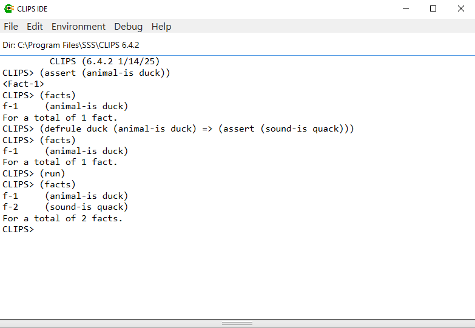
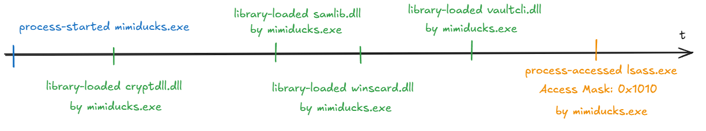
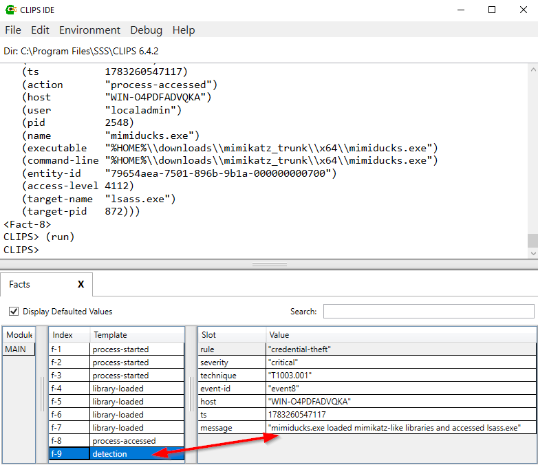
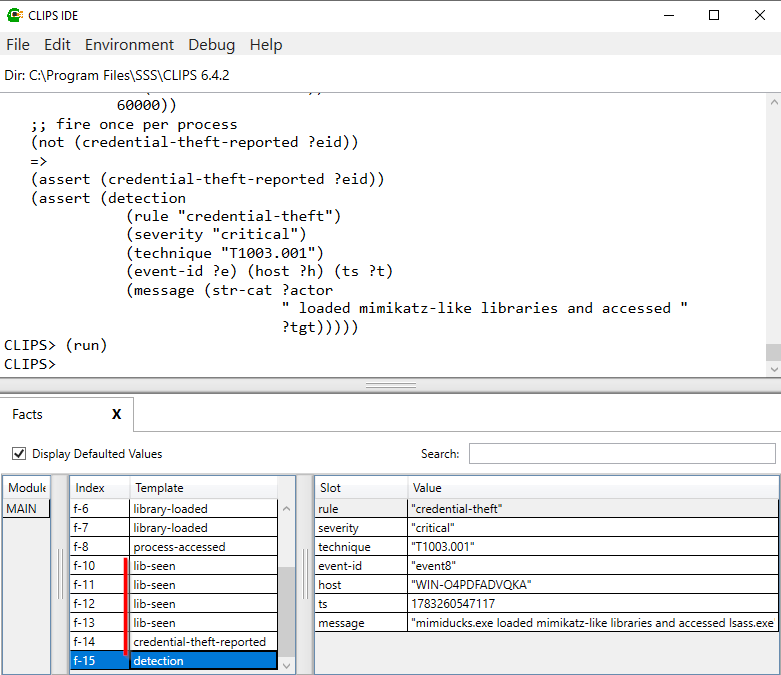

Recently a [blog post](https://web.archive.org/web/20260629035415/https://blog.otterpwn.com/projects/heavener) came to my attention. The author (otterpwn) presents a tool, called heavener, where they rip detection engines and ML classification models from various EDRs and duct-tape them together. They were able to achieve a very realistic emulation framework of what EDR agents are capable of detecting directly on the machine without relying on cloud components. Unsurprisingly, the blog post was quickly removed. In my opinion, this idea is a welcomed breath of fresh air in offensive research. I highly recommend reading the blog post while it's still available on the Wayback Machine (too late it's excluded now...).

One interesting part that stood out to me is the mention of [CLIPS production system](https://www.clipsrules.net/), designed by NASA in the mid-80s and internally used by Palo Alto Cortex agent. A few days later SpecterOps also published [their blog](https://specterops.io/blog/2026/06/29/llm-powered-edr-analysis/#h-behavioural-detections) on reversing EDR agents with particular focus on Palo Alto and CLIPS. So what exactly is CLIPS and why has Palo Alto decided to base their behavioral detection engine around it?

## Production systems and CLIPS

You can encounter [production systems](https://en.wikipedia.org/wiki/Production_system_(computer_science)) during undergraduate studies, as they are often part of curriculums covering basics of Artificial Intelligence. In the computer science sense of the word, before it became a synonym for LLMs. Production systems are made of rules (productions), which consist of two parts: the condition (left-hand side or LHS) and action (right-hand side or RHS). This is a convoluted way of saying `if ... then ...`. The second part of the system is a working memory. This is a database containing facts over which the rules are executed. The final part is inference engine, which controls the evaluation and prioritization of the rules.

Production systems can be used to create [expert systems](https://en.wikipedia.org/wiki/Expert_system). These are specialized systems intended to mimic human decision making.

C Language Integrated Production System, or CLIPS, is a programming language for writing such expert systems. It contains all three components needed, **fact-list** (database/memory), **knowledge-base** (ruleset) and **inference engine** (execution). Additionally, without the need of external runtime dependencies it's easily embeddable. You can download and install CLIPS from (yikes) [SourceForge](https://sourceforge.net/projects/clipsrules/files/CLIPS/6.4.2/). It includes the CLIPS IDE where you can start messing around with it. I recommend checking [Interfaces Guide](https://www.clipsrules.net/documentation/v642/ig642.pdf) and [User's Guide](https://www.clipsrules.net/documentation/v642/ug642.pdf) so that you are not completely lost.

Let's check the "Hello World" example from the User's guide, because it has ducks! Insert each line into the IDE separately.
```lisp
(assert (animal-is duck))
(facts)
(defrule duck (animal-is duck) => (assert (sound-is quack)))
(facts)
(run)
(facts)
```



What's with all those brackets? Well, CLIPS syntax is based on Lisp, so yeah you can get the feeling of just how old this software really is...

## What problem does it solve for EDRs?

You may be thinking, all of this is a cute software archeology exercise, but how does it relate to EDRs? EDRs observe telemetry events that endpoints generate, e.g. `process-started`, `process-ended`, `library-loaded`, `create-named-pipe` etc. and perform pattern matching on anomalous events that can correspond to TTPs.

The detection logic can be constructed for a single event e.g. if a process creates a named pipe that starts with `MSSE-` and ends with `-server`, you can be reasonably confident that this is a [Cobalt Strike beacon with default configuration](https://www.cobaltstrike.com/blog/learn-pipe-fitting-for-all-of-your-offense-projects). No need to correlate anything. Writing a stateless detection engine that evaluates a specific set of conditions on a single event is easy enough. But what if one telemetry event is not enough? Or it's too common to be useful and we need additional context?

Let's say that we have our own obfuscated version of Mimikatz called `mimiducks.exe` and we use `sekurlsa::logonpasswords`.
EDR would observe something similar to this:
 


Individually these events, viewed on their own, are quite common and noisy. When viewed together, they form a very different picture.

The usual approach is to create an engine with sequence matching support. Such an engine usually creates a state machine based on your query. If the state machine reaches an end state, the rule is triggered. Few reference implementations are publicly available, but one good example is [EQL](https://github.com/endgameinc/eql/blob/master/docs/query-guide/implementation.rst) language. Originally designed by Endgame and later incorporated into [Elasticsearch](https://www.elastic.co/docs/explore-analyze/query-filter/languages/eql) and also [Elastic Security for endpoint](https://github.com/elastic/protections-artifacts/blob/main/behavior/rules/windows/command_and_control_dns_over_https_by_an_unusual_process.toml) after Endgame was acquired by Elastic.

Implementing such an engine which is reasonably fast and works over large volumes of events on endpoint can be challenging. The problem can be approached differently. Think of an EDR as an expert system. Events can be mapped to facts stored in the fact-list. Then you have detection rules that are supposed to pattern match anomalous combinations of facts. Checking if they arrived in a specific sequence (or not) is just a condition in that pattern. The [Rete algorithm](https://en.wikipedia.org/wiki/Rete_algorithm) which CLIPS uses under the hood, is what makes it very efficient compared to sequence rules naively implemented as state machines. Rete uses partial matches to avoid re-evaluations of all facts each time a change to facts is made. The partial matches also use node sharing, so the same condition shared between rules is also evaluated only once.

## PoC using CLIPS

In our Mimikatz-like example it's not that important that the events occurred in the exact sequence. For simplicity's sake, let's first find any process that matches these conditions:

- Loads `cryptdll.dll`
- Loads `vaultcli.dll`
- Loads `samlib.dll`
- Opens handle to `lsass.exe`

We'll continue with the `mimiducks.exe` example and define templates for a few facts. If you're using CLIPS IDE, make sure to paste them individually.

Template for `process-started`:
```lisp
(deftemplate process-started
   (slot event-id         (type STRING)  (default ?NONE))
   (slot ts               (type INTEGER) (default 0))       ; epoch millis
   (slot action           (type STRING)  (default ""))
   (slot host             (type STRING)  (default ""))
   (slot user             (type STRING)  (default ""))
   (slot pid              (type INTEGER) (default -1))
   (slot ppid             (type INTEGER) (default -1))
   (slot name             (type STRING)  (default ""))
   (slot executable       (type STRING)  (default ""))
   (slot command-line     (type STRING)  (default ""))
   (slot entity-id        (type STRING)  (default ""))
   (slot parent-entity-id (type STRING)  (default ""))
   (slot parent-name      (type STRING)  (default "")))
```

Template for `process-accessed`:
```lisp
(deftemplate process-accessed
   (slot event-id         (type STRING)  (default ?NONE))
   (slot ts               (type INTEGER) (default 0))       ; epoch millis
   (slot action           (type STRING)  (default ""))
   (slot host             (type STRING)  (default ""))
   (slot user             (type STRING)  (default ""))
   (slot pid              (type INTEGER) (default -1))
   (slot name             (type STRING)  (default ""))
   (slot executable       (type STRING)  (default ""))
   (slot command-line     (type STRING)  (default ""))
   (slot entity-id        (type STRING)  (default ""))
   (slot access-level     (type INTEGER) (default 0))
   (slot target-name      (type STRING)  (default ""))
   (slot target-pid       (type INTEGER) (default -1)))
```

Template for `library-loaded`:
```lisp
(deftemplate library-loaded
   (slot event-id         (type STRING)  (default ?NONE))
   (slot ts               (type INTEGER) (default 0))       ; epoch millis
   (slot action           (type STRING)  (default ""))
   (slot host             (type STRING)  (default ""))
   (slot user             (type STRING)  (default ""))
   (slot pid              (type INTEGER) (default -1))
   (slot name             (type STRING)  (default ""))
   (slot executable       (type STRING)  (default ""))
   (slot command-line     (type STRING)  (default ""))
   (slot entity-id        (type STRING)  (default ""))
   (slot library-name     (type STRING)  (default "")))
```

Template for `detection`, each rule will emit detection fact when matched:
```lisp
(deftemplate detection
   (slot rule      (type STRING))
   (slot severity  (type STRING)  (default "medium"))
   (slot technique (type STRING)  (default ""))
   (slot event-id  (type STRING)  (default ""))
   (slot host      (type STRING)  (default ""))
   (slot ts        (type INTEGER) (default 0))
   (slot message   (type STRING)  (default "")))
```

Now let's try to write a rule that matches our conditions:

```lisp
(defrule credential-theft
   (process-accessed (entity-id ?eid&~"")
                     (name ?actor)
                     (target-name ?tgt)
                     (event-id ?e) (host ?h) (ts ?t))
   (test (str-index "lsass" (lowcase ?tgt)))
   (exists (library-loaded
              (entity-id ?eid)
              (library-name ?lib1&:(str-index "samlib"
                                                (lowcase ?lib1)))))
   (exists (library-loaded
              (entity-id ?eid)
              (library-name ?lib2&:(str-index "vaultcli"
                                                (lowcase ?lib2)))))
   (exists (library-loaded
              (entity-id ?eid)
              (library-name ?lib3&:(str-index "cryptdll"
                                                (lowcase ?lib3)))))
   =>
   (assert (detection
              (rule "credential-theft")
              (severity "critical")
              (technique "T1003.001")
              (event-id ?e) (host ?h) (ts ?t)
              (message (str-cat ?actor
                                " loaded mimikatz-like libraries and accessed "
                                ?tgt)))))
```

We can load CLIPS with example facts. In [events.clp](./assets/events.clp) you can find real events I've captured using an EDR and converted. Again, paste them individually into the CLIPS IDE or use `(batch "events.clp")`. You can use **Debug->Fact Browser** to view the fact-list. Only a subset of the events will be used in our pattern matching, for example `winscard.dll` is unused.

After the last fact was added trigger the rule evaluation using `(run)`. A new fact should appear:



You can try running `(run)` after every fact to see that the rule really triggers only after `event8` is added.

Now our rule doesn't check if the events arrived in a specific order, it can be modified to do so, but maybe it's not the best idea. Changing the order of DLLs loaded is trivial. What we actually need is for the events to occur within a specific time window. There is also a second problem that may not be immediately obvious. We don't want to store a new fact each time a process loads the same DLL. The same DLL can be loaded multiple times during the lifecycle of a process. CLIPS keeps partial matches in memory and each `library-loaded` event that fits our criteria would create such a partial match.

We can add a rule that will help us keep track of DLLs we've seen for a specific process:
```lisp
(deftemplate lib-seen
   (slot entity-id (type STRING)  (default ?NONE))
   (slot library   (type STRING)  (default ?NONE))
   (slot ts        (type INTEGER) (default 0)))

;; collapse repeated loads of the same module into one fact per (process, library)
(defrule normalise-library-load
   (library-loaded (entity-id ?eid&~"") (library-name ?lib) (ts ?t))
   (not (lib-seen (entity-id ?eid) (library =(lowcase ?lib))))
   =>
   (assert (lib-seen (entity-id ?eid) (library (lowcase ?lib)) (ts ?t))))
```

The rule can be modified as follows (this will replace the existing rule within CLIPS):

```lisp
(defrule credential-theft
   ;; the three credential-theft DLLs, in any order
   (lib-seen (entity-id ?eid&~"") (library ?l1&:(str-index "cryptdll" ?l1)) (ts ?t1))
   (lib-seen (entity-id ?eid)     (library ?l2&:(str-index "samlib"   ?l2)) (ts ?t2))
   (lib-seen (entity-id ?eid)     (library ?l3&:(str-index "vaultcli" ?l3)) (ts ?t3))
   ;; the LSASS access, also in any order relative to the loads
   (process-accessed (entity-id ?eid)
                     (name ?actor)
                     (target-name ?tgt&:(str-index "lsass" (lowcase ?tgt)))
                     (event-id ?e) (host ?h) (ts ?t))
   ;; all four events must span no more than 60 s
   (test (<= (- (max ?t1 ?t2 ?t3 ?t)
                (min ?t1 ?t2 ?t3 ?t))
             60000))
   ;; fire once per process
   (not (credential-theft-reported ?eid))
   =>
   (assert (credential-theft-reported ?eid))
   (assert (detection
              (rule "credential-theft")
              (severity "critical")
              (technique "T1003.001")
              (event-id ?e) (host ?h) (ts ?t)
              (message (str-cat ?actor
                                " loaded mimikatz-like libraries and accessed "
                                ?tgt)))))
```

Now it checks for a 60 second time window and uses an additional fact as a guard to only trigger one detection per process. We've also handled the problem with repeating events creating unnecessary partial matches, but at a cost of new facts being created for each unique DLL load per-process. We've traded one problem for another. So there is still space for further improvement. Before running the rule don't forget to retract the detection fact from previous run, otherwise no a new detection fact for the same rule won't be added.



There are additional challenges that need to be solved before CLIPS can be turned into a detection engine for an EDR agent. Since CLIPS lacks event expiry, you need to regularly retract facts, otherwise they'll just keep piling up in memory. Facts related to a process can be retracted when `process-ended` is received and also a scheduled cleaning of old facts will be necessary.

## What can we learn from it?

I would be really interested to know how detection engineers at Palo Alto view CLIPS. Is it a cumbersome piece of legacy code that they are forced to maintain because porting thousands of rules that run on millions of endpoints is just a [huge risk](https://en.wikipedia.org/wiki/2024_CrowdStrike-related_IT_outages)? Do the advantages of an easily embeddable engine and built-in Rete algorithm outweigh the problems? I can definitely see many possibilities it opens, but maintaining such an old component in your codebase comes with a cost.

The DFIR community can still very much benefit from CLIPS, there are very few open-source tools that provide any sort of correlation capable detection engine. CLIPS seems like a viable platform to build a DFIR tool around. I can see this being used for offline log analysis, where you can mostly utilize the pattern matching capabilities, without the need to worry too much about maintenance of the fact-list or other problems a live EDR agent could face.